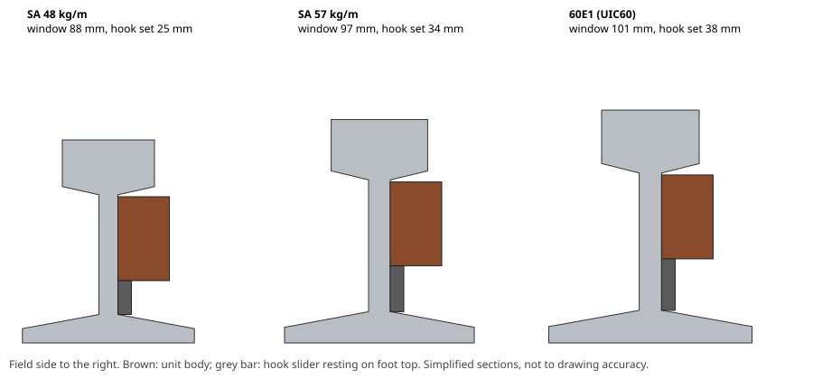

# Tier 1 desk-only verification report

Generated by `verification/run_all.py`. Do not edit by hand.

**Overall: PASS** (39 analysis checks, firmware tests PASS, platform tests PASS)

## Analysis checks by requirement

| Req | Checks | Result |
|---|---|---|
| T1-01 | 2 | PASS |
| T1-07 | 5 | PASS |
| T1-08 | 2 | PASS |
| T1-10 | 4 | PASS |
| T1-11 | 2 | PASS |
| T1-12 | 13 | PASS |
| T1-16 | 6 | PASS |
| T1-17 | 2 | PASS |
| — | 3 | PASS |

## Analysis detail

### LoRa airtime, duty cycle and range

PHY payload 32 B (app 19 B + LoRaWAN 13 B), 144 uplinks/day.

| SF | Airtime (ms) | Airtime/day (s) | Duty (%) | Within 30 s/day fair use | Charge/uplink (µAh) | Range, 6 m GW (m) | Range, 15 m GW (m) |
|---|---|---|---|---|---|---|---|
| SF7 | 71.9 | 10.4 | 0.012 | yes | 1.6 | 805 | 1273 |
| SF8 | 133.6 | 19.2 | 0.022 | yes | 2.4 | 957 | 1513 |
| SF9 | 246.8 | 35.5 | 0.041 | no | 3.8 | 1137 | 1798 |
| SF10 | 452.6 | 65.2 | 0.075 | no | 6.4 | 1352 | 2137 |
| SF11 | 987.1 | 142.1 | 0.165 | no | 13.2 | 1561 | 2468 |
| SF12 | 1810.4 | 260.7 | 0.302 | no | 23.7 | 1702 | 2691 |

Range includes 10 dB rail-shadow excess loss and 10 dB fade margin; node antenna 0.15 m above ballast.

| Req | Check | Value | Limit | Result |
|---|---|---|---|---|
| T1-16 | EU868 duty cycle at SF7, 144 uplinks/day | 0.012 % | <= 1 % | PASS |
| T1-16 | EU868 duty cycle at SF8, 144 uplinks/day | 0.022 % | <= 1 % | PASS |
| T1-16 | EU868 duty cycle at SF9, 144 uplinks/day | 0.041 % | <= 1 % | PASS |
| T1-16 | EU868 duty cycle at SF10, 144 uplinks/day | 0.075 % | <= 1 % | PASS |
| T1-16 | EU868 duty cycle at SF11, 144 uplinks/day | 0.165 % | <= 1 % | PASS |
| T1-16 | EU868 duty cycle at SF12, 144 uplinks/day | 0.302 % | <= 1 % | PASS |

### Battery life

Usable 12000 mAh of a 17000 mAh cell; self-discharge 1 %/yr; life capped at 12 yr calendar. HOT season 120 days x 6 h.

| SKU | Case | HOT reporting | mAh/day | Life (yr) |
|---|---|---|---|---|
| LoRa | SF7 | - | 0.46 | 12.0 |
| LoRa | SF8 | - | 0.60 | 12.0 |
| LoRa | SF9 | - | 0.84 | 12.0 |
| LoRa | SF10 | - | 1.29 | 12.0 |
| LoRa | SF11 | - | 2.45 | 11.3 |
| LoRa | SF12 | - | 4.24 | 7.0 |
| LTE-M opt A | good, typical | 10 min | 8.49 | 3.7 |
| LTE-M opt A | good, worst | 10 min | 12.59 | 2.5 |
| LTE-M opt A | deep (x3), typical | 10 min | 24.90 | 1.3 |
| LTE-M opt B (adopted) | good, typical | 20 min | 5.40 | 5.6 |
| LTE-M opt B (adopted) | good, worst | 20 min | 7.96 | 3.9 |
| LTE-M opt B (adopted) | deep (x3), typical | 20 min | 15.64 | 2.0 |
| LTE-M opt B | good, worst + 10% outage, naive retry every tick [rejected] | 20 min | 23.21 | 1.4 |
| LTE-M opt B | good, worst + 10% outage, firmware back-off (R-9 fix) | 20 min | 9.39 | 3.3 |

| Req | Check | Value | Limit | Result |
|---|---|---|---|---|
| T1-07 | LoRa SKU life at SF7 | 12.0 yr | >= 7 yr | PASS |
| T1-07 | LoRa SKU life at SF8 | 12.0 yr | >= 7 yr | PASS |
| T1-07 | LTE-M SKU life, option B, good, typical | 5.6 yr | >= 3 yr | PASS |
| T1-07 | LTE-M SKU life, option B, good, worst | 3.9 yr | >= 3 yr | PASS |
| T1-07 | LTE-M SKU life, option B, good worst, with 10 % outage and back-off | 3.3 yr | >= 3 yr | PASS |

### Thermal FEM of the sensing pot

Axisymmetric steady conduction through pot C (steel cup k 50, NdFeB k 9, epoxy gap k 0.2) from the rail contact film to the TMP117 pad. Results replace the assumed lumped values in the thermal model (previously G_contact 0.50 / 0.15 W/K, C 28 J/K).

| Case | Contact film h (W/m²K) | G_contact (W/K) | G_contact, fine grid (W/K) | C_elem (J/K) | C/G (s) |
|---|---|---|---|---|---|
| nominal | 3000 | 0.352 | 0.352 | 23.3 | 66 |
| worst | 500 | 0.188 | 0.188 | 23.3 | 124 |

| Req | Check | Value | Limit | Result |
|---|---|---|---|---|
| — | Thermal FEM grid convergence (0.10 vs 0.05 mm cells) | within 3 % | < 3 % | PASS |

### Thermal: rail reading error and housing temperature

Cases: nominal (good contact 0.20 W/K, grey cap α 0.35, 10 W/m²K wind, 0.004 m² sunlit) and worst (rusty contact 0.05 W/K, rust body α 0.80, still air 3 W/m²K, 0.008 m² sunlit, double internal leakage).

| Case | Rail max (°C) | Housing max (°C) | Max |error| all day (°C) | Max |error| with lag comp. (°C) | Time constant (s) | Near-rail air bias vs air, max (°C) |
|---|---|---|---|---|---|---|
| A: sprung brass slug, unguarded / nominal | 69.0 | 49.0 | 2.067 | 2.014 | 30 | +4.2 |
| A: sprung brass slug, unguarded / worst | 69.0 | 63.8 | 1.777 | 1.783 | 116 | +8.1 |
| B: sprung brass slug, guarded / nominal | 69.0 | 50.0 | 0.314 | 0.362 | 30 | +4.5 |
| B: sprung brass slug, guarded / worst | 69.0 | 64.1 | 0.605 | 0.544 | 116 | +8.2 |
| C: sensor on centre pot cup, guarded (D-12) / nominal | 69.0 | 50.0 | 0.284 | 0.252 | 68 | +4.5 |
| C: sensor on centre pot cup, guarded (D-12) / worst | 69.0 | 64.1 | 0.429 | 0.235 | 126 | +8.2 |

Error budget: 0.5 °C installed = TMP117 0.2 °C + mounting ≤ 0.3 °C (linear sum).

Variant C uses geometry-derived contact conductance and capacity from the thermal FEM. Lag compensation uses the firmware's compiled constant τ = 150 s; the minimax optimum for these cases is 130 s (worst error 0.228 °C vs 0.252 °C at the firmware value).

| Req | Check | Value | Limit | Result |
|---|---|---|---|---|
| T1-01 | Mounting error with lag compensation, C: sensor on centre pot cup, guarded (D-12) / nominal | 0.252 °C | <= 0.3 °C | PASS |
| T1-08 | Housing peak temperature, C: sensor on centre pot cup, guarded (D-12) / nominal | 50.0 °C | <= 85 °C | PASS |
| T1-01 | Mounting error with lag compensation, C: sensor on centre pot cup, guarded (D-12) / worst | 0.235 °C | <= 0.3 °C | PASS |
| T1-08 | Housing peak temperature, C: sensor on centre pot cup, guarded (D-12) / worst | 64.1 °C | <= 85 °C | PASS |

### Magnetostatic FEM: pull vs gap and attachment sensing

Axisymmetric nonlinear finite-volume model of one Ø32 mm pot (NdFeB 35SH, Br 1.20 T at 20 °C, −0.12 %/K) on a 15 mm rail-steel plate (pearlitic R260 modelled at 2× the field strength of mild steel for the same flux density). Force from the Maxwell stress in the gap. Solver validated against the analytic on-axis field of a bare disc magnet (within 3 %). Absolute values calibrated to the catalogue rating (334 N, zero gap, mild steel); raw FEM over-predicted by 1.59× because the pot's internal dimensions are assumed. Single pot; neighbour interaction and web curvature not modelled.

| Gap (mm) | Pull, rail steel 20 °C (N) | Pull, rail steel 80 °C (N) | Analytic model used so far (N) | FEM 80 °C / analytic |
|---|---|---|---|---|
| 0.05 | 332 | 301 | 308 | 0.98 |
| 0.10 | 295 | 264 | 284 | 0.93 |
| 0.20 | 239 | 210 | 245 | 0.86 |
| 0.30 | 201 | 175 | 214 | 0.82 |
| 0.45 | 161 | 139 | 177 | 0.79 |
| 0.60 | 134 | 116 | 149 | 0.78 |
| 0.80 | 109 | 94 | 121 | 0.78 |
| 1.00 | 91 | 78 | 100 | 0.79 |

Hall-sensor field |B| at candidate positions, 0.3 mm gap (attached) vs no rail (detached), 20 °C:

| Position | Attached (mT) | Detached (mT) | Usable |
|---|---|---|---|
| behind, on axis (+4 mm) | 17.1 | 12.8 | no |
| behind, at rim (+4 mm) | 23.6 | 17.7 | no |
| beside rim (+3 mm, mid-height) | 56.2 | 36.8 | yes |
| beside rim (+3 mm, face level) | 68.7 | 43.4 | yes |
| beside rim (+2 mm, face level) [adopted] | 102.4 | 58.9 | yes |

Usable = one state ≥ 10.5 mT and the other ≤ 0.7 mT, or a change ≥ 14 mT. No position gives a near-zero state, and |B| is not even monotonic with gap (at 0.05 mm it nearly equals the detached value while the radial component differs strongly), so a fixed-threshold switch is rejected. Adopted: 3-D linear Hall sensor 2 mm beside the outer rim of an end pot at face level (position chosen by a sweep of 1–8 mm × 0.5–4 mm; ±0.3 mm pocket tolerance); attached when the vector distance ‖B − B_ref‖ > 10 mT, with B_ref the detached field recorded at the factory.

| Req | Check | Value | Limit | Result |
|---|---|---|---|---|
| — | Magnetostatic solver vs analytic disc-magnet field (on axis, 4 points) | 1.3 % | <= 5 % | PASS |
| — | FEM nonlinear convergence (99th-percentile log-reluctivity step) | 0.020 | <= 0.05 | PASS |
| T1-17 | Fixed-threshold Hall switch usable (original D-18) [rejected option] | beside rim (+2 mm, face level) [adopted] | one state ≤ 0.7 mT | FAIL |
| T1-17 | 3-D Hall (D-18 rev): min ‖B − B_ref‖ attached, gaps 0.05–1 mm, 20/80 °C, ±0.3 mm placement | 22.8 mT | >= 20 mT (2× threshold) | PASS |
| T1-17 | 3-D Hall (D-18 rev): detached ‖B − B_ref‖ drift 20→80 °C, ±0.3 mm placement | 4.8 mT | <= 5 mT (½ threshold) | PASS |

### Retention under on-rail vibration

Mass 0.6 kg; 3 × 34 kgf pot magnets; 3σ peaks of EN 50125-3 RMS values (vertical 280, lateral 140, longitudinal 50 m/s², unconfirmed); margin 1.5×.

| Quantity | Value |
|---|---|
| Pull source | calibrated FEM, rail steel, 80 °C |
| Pull at 0.05 mm gap | 904 N |
| Pull at worst gap 0.4 mm | 453 N |
| Friction, bare pot face (µ 0.15) | 68 N |
| Friction, PU-coated pot face (µ 0.5) | 227 N |
| Friction, adopted mix (2 coated + 1 bare, µ 0.38) | 174 N |
| Design load, lateral (pull-off) | 378 N |
| Design load, longitudinal | 135 N |
| Design load, vertical (incl. weight) | 765 N |
| Old rule: 10 x weight in shear | 59 N |

| Req | Check | Value | Limit | Result |
|---|---|---|---|---|
| T1-11 | Pull-off: magnet pull at worst gap vs lateral design load | 453 N | >= 378 N | PASS |
| T1-11 | Longitudinal: friction (bare face) vs design load [rejected option] | 68 N | >= 135 N | FAIL |
| T1-11 | Longitudinal: friction (2 coated + 1 bare pot, D-14) vs design load | 174 N | >= 135 N | PASS |
| T1-10 | Vertical: magnet friction alone vs design load [rejected option] | 227 N | >= 765 N | FAIL |
| T1-10 | Hook root bending stress at design load (10 mm PA6-GF30, 6 mm lever) | 9.2 MPa | <= 20 MPa (fatigue, 80 °C) | PASS |

**Result.** Magnets alone cannot hold the unit vertically against on-rail vibration (the old "10 × weight" rule under-states the load by about 13×). Adopted design (D-14): PU-coated pot faces for longitudinal friction on the two outer pots (centre pot left bare for thermal contact), and geometric capture between a rail-foot hook and a rail-head stop. Derived requirement for mechanical design: hook and stop each carry ≥ 765 N; the hook is sized for bending fatigue in the check above.

### Modal check of compliant parts

Band upper limit assumed 2000 Hz (EN 50125-3 spectrum not confirmed); required first mode ≥ 2500 Hz. Body rigid-body modes are not limiting while magnetic preload keeps steel contact (see retention).

| Part | First mode (Hz) | Status |
|---|---|---|
| Hook lip, 10 mm lever (original) | 1258 | rejected |
| Hook lip, 6 mm lever (D-25) | 2707 | adopted |
| PCB 50 × 40 mm, 4 corner screws | 1240 | rejected |
| PCB with centre standoff (D-26, ~25 × 20 mm panels) | 4958 | adopted |
| D-cell on 2 mm EPDM pads | 894 | rejected |
| D-cell in rigid cradle, 0.5 mm Shore-90 PU liner (D-27) | 5657 | adopted |

| Req | Check | Value | Limit | Result |
|---|---|---|---|---|
| T1-10 | First mode: Hook lip, 6 mm lever (D-25) | 2707 Hz | >= 2500 Hz | PASS |
| T1-10 | First mode: PCB with centre standoff (D-26, ~25 × 20 mm panels) | 4958 Hz | >= 2500 Hz | PASS |
| T1-10 | First mode: D-cell in rigid cradle, 0.5 mm Shore-90 PU liner (D-27) | 5657 Hz | >= 2500 Hz | PASS |

### Mass budget

| Item | g |
|---|---|
| Housing body + top cap, PA6-GF30/ASA, 3 mm wall | 150 |
| 3 x Ø32 NdFeB SH pot magnets (steel cup) | 180 |
| Steel thermal guard bridge | 40 |
| Li-SOCl2 D-cell | 95 |
| Hybrid layer capacitor | 10 |
| PCB + module + sensors + antenna | 22 |
| Hook slider, PA6-GF30 | 25 |
| Lid, gasket, vent, security screws | 30 |
| Potting / cell clamp / thermal pad / foam | 25 |
| **Total** | **577** |

Margin 23 g (4 %).

| Req | Check | Value | Limit | Result |
|---|---|---|---|---|
| T1-12 | Mass budget | 577 g | <= 600 g | PASS |

### Fit on rail profiles

Body 110 × 62 × 38 mm (L × H × D); hook slider 14–50 mm in 1 mm detents; head-stop clearance 1.5 mm. Web window estimated at 0.59 × rail height, checked at ±10 %.

| Profile | Web window (mm) | Hook setting (mm) | Head overhang (mm) | Protrusion beyond head edge (mm) |
|---|---|---|---|---|
| SA 48 kg/m | 88 | 25 | 27.0 | 11.0 |
| SA 57 kg/m | 97 | 34 | 27.6 | 10.4 |
| 60E1 (UIC60) | 101 | 38 | 27.8 | 10.2 |

The unit protrudes beyond the head edge on the **field side only**, below head level, so it is outside the wheel/flange zone.



| Req | Check | Value | Limit | Result |
|---|---|---|---|---|
| T1-12 | SA 48 kg/m, window nominal: hook setting in slider range | 25.0 mm | 14–50 mm | PASS |
| T1-12 | SA 48 kg/m: unit stays inside foot overhang (clear of ballast-side edge) | 38 mm | <= 56.5 mm | PASS |
| T1-12 | SA 48 kg/m, window -10 %: hook setting in slider range | 16.2 mm | 14–50 mm | PASS |
| T1-12 | SA 48 kg/m, window +10 %: hook setting in slider range | 33.9 mm | 14–50 mm | PASS |
| T1-12 | SA 57 kg/m, window nominal: hook setting in slider range | 33.8 mm | 14–50 mm | PASS |
| T1-12 | SA 57 kg/m: unit stays inside foot overhang (clear of ballast-side edge) | 38 mm | <= 62.0 mm | PASS |
| T1-12 | SA 57 kg/m, window -10 %: hook setting in slider range | 24.1 mm | 14–50 mm | PASS |
| T1-12 | SA 57 kg/m, window +10 %: hook setting in slider range | 43.6 mm | 14–50 mm | PASS |
| T1-12 | 60E1 (UIC60), window nominal: hook setting in slider range | 38.0 mm | 14–50 mm | PASS |
| T1-12 | 60E1 (UIC60): unit stays inside foot overhang (clear of ballast-side edge) | 38 mm | <= 66.8 mm | PASS |
| T1-12 | 60E1 (UIC60), window -10 %: hook setting in slider range | 27.8 mm | 14–50 mm | PASS |
| T1-12 | 60E1 (UIC60), window +10 %: hook setting in slider range | 48.1 mm | 14–50 mm | PASS |

## Firmware tests (`make test`)

```
[PASS] rtsm: service mode suppresses tamper, back to SHIP
[PASS] rtsm: unlock with wrong/right token
[PASS] rtsm: low battery alarm once, re-arm above 15%
[PASS] rtsm: sensor fault episode handling
[PASS] rtsm: seq wraps and stays gap-free
[PASS] rtsm: D-13 lag compensation unit
[PASS] rtsm: D-13 lag compensation in the data path
[PASS] rtsm: time sync offsets timestamps
[PASS] rtsm: next wake-up
[PASS] nvstate: record encode/decode, CRC-32
[PASS] nvstate: reset mid-RUN resumes RUN, config kept, no seq reuse
[PASS] nvstate: seq block reservation across reset
[PASS] nvstate: reset in LOCKED stays LOCKED
[PASS] nvstate: token rotation and service SHIP persisted
[PASS] nvstate: corrupt slot A falls back to slot B
[PASS] nvstate: both slots corrupt -> SHIP factory defaults
    info: 30 days steady: LoRa 17 NV writes / 4350 uplinks, LTE-M 5 NV writes / 750 uplinks
[PASS] nvstate: flash wear bound in steady operation
    info: LTE-M 48 h outage, link unknown: 27 status/data attempts (288 before)
[PASS] rtsm: 48 h outage LTE-M, link unknown: long back-off, exactly once
    info: LoRa 48 h outage, link unknown: 27 status/data attempts (288 before)
[PASS] rtsm: 48 h outage LoRa, link unknown: long back-off, no loss
[PASS] rtsm: link_available()=0: no data attempts, alarms every tick

47 tests, 14593 checks, 0 failed tests, 0 failed checks
```

## Platform tests (`python -m unittest test_codec`)

```
test_example_site_config_is_18_bytes (test_codec.Config.test_example_site_config_is_18_bytes) ... ok
test_rejects_invalid (test_codec.Config.test_rejects_invalid) ... ok
test_alarm_level_bits (test_codec.Decode.test_alarm_level_bits) ... ok
test_batch_times_and_fault (test_codec.Decode.test_batch_times_and_fault) ... ok
test_length_errors (test_codec.Decode.test_length_errors) ... ok
test_downlink_config_vector_matches_encoder (test_codec.FirmwareVectors.test_downlink_config_vector_matches_encoder) ... ok
test_fields_match (test_codec.FirmwareVectors.test_fields_match) ... ok
test_vectors_present_for_every_uplink_type (test_codec.FirmwareVectors.test_vectors_present_for_every_uplink_type) ... ok
test_gap_detection (test_codec.Ingest.test_gap_detection) ... ok
test_overlapping_lora_batches_and_duplicates (test_codec.Ingest.test_overlapping_lora_batches_and_duplicates) ... ok

----------------------------------------------------------------------
Ran 10 tests in 0.001s

OK
```
